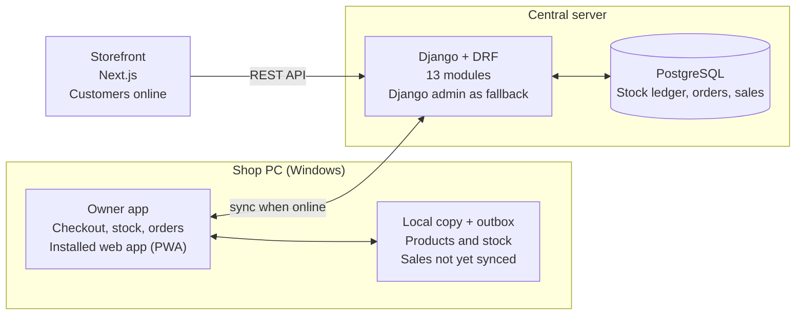
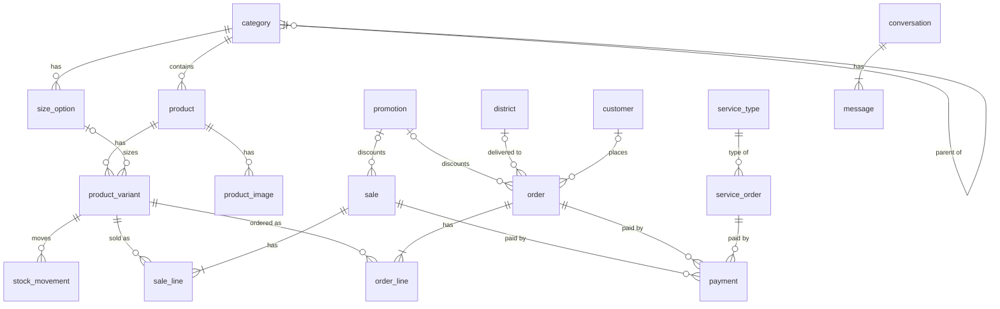

# VNimavum architecture

Agreed with the owner on 2026-10-11. The working copy, with the discussion
history, is the
[architecture doc](https://claude.ai/code/artifact/f93f7510-71b9-41d7-b597-48563b35dd81).
Decisions are also recorded in [CLAUDE.md](../CLAUDE.md).

## Summary

The owner app is installed on the shop's Windows PC and keeps its own copy of
products and stock, so in-store checkout keeps working when the internet is
down. It saves every in-store sale locally first, then syncs to the central
Django server when the connection returns.

- **Central server** (Django + DRF + PostgreSQL) is the single source of truth
  for products, stock, online orders and in-store sales.
- **Owner app** is a small React app the owner installs on Windows from the
  browser as an installable web app (PWA). It opens in its own window from the
  Start menu and asks the browser to keep its storage permanently.
- **Stock is a ledger** of movements (sold in store, sold online, received,
  adjusted), not a single number that people overwrite. That is what lets
  offline sales merge cleanly with online orders later.
- **Shared modules**: the backend is split into small Django apps, and the owner
  app and storefront share one UI package for a unified look.

The owner app is the daily tool. Django admin stays as a back-office fallback.

During development, the central server and the owner app both run on localhost
on the developer's Windows laptop. A private server comes later.

## What the owner app covers

The system has two parts: the customer storefront, and the owner app. The owner
app includes the cashier checkout, which only the owner uses.

| Area | What it does | Offline |
| --- | --- | --- |
| Checkout | The owner rings up in-store sales as the cashier | Yes |
| In-store payments | Cash; bank transfer with a reference number; a bank card reader connected later | Yes, apart from the card reader |
| Cash for the day | Running total of the cash that should be in the shop today | Yes |
| Sewing jobs | Service orders for customers who bring their own material | Yes |
| Products | Categories (curtains, cushions, candles, bedsheets, pillows and more) define which variants a product has: size, colour or pattern, material | Viewing, yes |
| Stock | Counts per variant, stock received, adjustments | Sales lower stock offline; other changes need internet |
| Online orders | View and update orders paid by Visa, Mastercard, bank transfer or PayPal | No |
| Inbox | Threaded chats customers start on the website | No |
| Delivery | Delivery within Sri Lanka with fees shown, plus in-store pickup; overseas left open for later | No |
| Currency | Several currencies, converted with Frankfurter rates | Uses the last rates downloaded |

The storefront offers guest checkout and customer accounts. The language is
English only, and there is no tax for now.

## At a glance

The owner app works from its local copy and syncs both ways with Django
whenever the shop is online. The storefront always talks to Django directly.

## How offline works

The owner app never waits for the server: it reads from its local copy and
writes to a local outbox, and a sync step runs whenever the PC is online.

1. **Local copy.** On startup and every few minutes while online, the app
   downloads products, prices and current stock into the PC's browser storage
   (IndexedDB).
2. **Checkout offline.** A sale is saved locally with its own unique ID, the
   receipt is shown, and local stock drops at once. Nothing is lost if the
   internet or power cuts out after that point.
3. **Outbox.** Each in-store sale waits in an outbox until the server confirms
   it.
4. **Sync.** When online, the app sends the outbox, then pulls what changed on
   the server (new online orders, edits made elsewhere). Because each entry
   carries its own ID, sending it twice never counts it twice.
5. **Merging stock.** The server adds the shop's movements to the same ledger as
   online orders, so the true count is always the sum of all movements.
   Nobody's change overwrites anyone else's.

**Known limit.** While the shop is offline, the website keeps selling from the
server's count and can't see in-store sales yet. The last unit of an item could
be sold twice. At under 100 orders a day this should be rare, and the owner
sorts it out with the customer, for example with a refund. The owner app shows
a notification whenever the last unit sells online.

## Modules

Each module owns one job and talks to the others through a small, named
interface, so it can be changed or reused without touching the rest.

### Backend (Django apps inside `backend/`)

| Module | Owns | Used by |
| --- | --- | --- |
| `catalog` | Categories and their sizes, products, variants, prices, images | Owner app, storefront |
| `inventory` | Stock ledger: every movement in or out per variant, and the current count | Sales, orders, services |
| `sales` | In-store sales, receipts and the daily cash total | Owner app |
| `payments` | Every payment and refund, and how it was made: cash, bank transfer reference, card, PayPal | Sales, orders, services |
| `orders` | Online orders and their status | Storefront, owner app |
| `delivery` | Delivery districts and fees in Sri Lanka, in-store pickup, with a country table ready for overseas | Orders, storefront |
| `currency` | Currencies and conversion rates fetched from Frankfurter | Anything with a price |
| `customers` | Customer accounts and saved addresses | Storefront, orders |
| `promotions` | Promotion codes for in-store sales and online orders | Sales, orders |
| `services` | Sewing jobs (service orders) | Owner app |
| `inbox` | Threaded chats from the website | Storefront, owner app |
| `sync` | Accepts the owner app's outbox and serves "what changed since" | Owner app |
| `accounts` | Owner and staff logins and permissions (Django's own tables) | Everything |

Only `inventory` changes stock. `sales`, `orders` and `services` ask it to
record a movement, so stock rules live in one place.

What each of the money and stock modules is for:

- **inventory** answers "how many do we have?" Example movements: +20 white
  queen bedsheets received, −1 sold in store, −1 sold online, −2 damaged. It
  knows nothing about prices or customers.
- **sales** is the cashier counter: receipt S-0104 for 2 cushions, and the
  day's expected cash.
- **orders** is an online order's life: contact details, delivery or pickup,
  fee, and status.
- **payments** records the money itself, wherever it came from. The card
  reader, the online gateway and refunds plug into one place.

One in-store sale touches three modules: **sales** creates the receipt,
**payments** records the cash, and **inventory** records −1.

### Frontend (JavaScript)

| Module | What it is |
| --- | --- |
| `owner-app/` | The installable owner app (React) |
| `storefront/` | The customer site (Next.js) |
| `shared/ui` | Shared buttons, forms, tables, colours and fonts, for the unified look |
| `shared/api-client` | One typed client for the Django API, used by both apps |

For now `shared/ui` holds plain, minimal components only; the unified visual
design comes later.

## Decisions

| Topic | Decision (2026-10-11) |
| --- | --- |
| Owner app | The daily tool, including the cashier checkout. An installable web app that keeps its storage permanently. |
| Offline scope | In-store sales and sewing jobs. Everything else needs internet. |
| Devices | One in-store device. |
| Last unit sold online | The owner app shows a notification. If an outage causes an oversell, the owner sorts it out with the customer, for example with a refund. |
| Online orders | Customer name, phone and email are always required; the address is required for delivery only. |
| Primary currency | LKR. Prices are set in LKR only; customers can view converted prices. |
| Rate service | [Frankfurter](https://frankfurter.dev/), which carries Central Bank of Sri Lanka rates. The owner can override a rate. |
| Local setup | PostgreSQL in Docker, with Django and the apps run directly from VS Code on localhost. |
| Versions | Current long-term-support versions of the stack. |
| Hosting | A private server, later. |
| Still open | Online card payment gateway, to be researched later. |

## Database model

There are 25 tables of our own across 13 modules. Every money amount is stored
in LKR as a decimal with 2 places. Records the shop PC can create offline
(sales, sale lines, payments, stock movements, sewing jobs) use random IDs
(UUIDs), so they never clash when they sync. All other tables use plain numbers
as IDs. Django prefixes each table with its module name in the database (for
example `catalog_product`).

### catalog

| Table | Fields | Notes |
| --- | --- | --- |
| `category` | name, parent (category, optional), is_active, sort_order | Nested; a product belongs to one category |
| `size_option` | category, name (e.g. Queen), dimensions (optional text, e.g. 60 x 80 in), sort_order | The fixed sizes the owner defines per category. Subcategories use their parent's sizes unless they define their own |
| `product` | category, name, description, is_active, created_at, updated_at | |
| `product_variant` | product, sku (unique, generated), size (size_option, optional), colour_pattern (text, optional), material (text, optional), price_lkr, is_active | One row per sellable item. SKU format VN-00001, printed as a Code 128 barcode |
| `product_image` | product, variant (optional), image, alt_text, sort_order | Product images, optionally tied to one variant |

### inventory

| Table | Fields | Notes |
| --- | --- | --- |
| `stock_movement` | id (UUID), variant, quantity (+ in, − out), reason, unit_cost_lkr (on received only), sale (optional), order (optional), service_order (optional), note, created_at, created_by | Reasons: received, sold in store, sold online, returned, damaged, count correction, used in sewing job. The stock count is the sum of quantities |
| `stock_alert` | variant, order, created_at, read_at | Created when the last unit sells online; shown in the owner app |

### sales

| Table | Fields | Notes |
| --- | --- | --- |
| `sale` | id (UUID), receipt_number (S-0001), subtotal_lkr, discount_lkr, promotion (optional), total_lkr, receipt_email (optional), created_at | One in-store sale; the receipt is shown on screen, printable, and can be emailed |
| `sale_line` | id (UUID), sale, variant, quantity, unit_price_lkr, line_total_lkr | Prices copied at sale time, so later price changes don't alter old receipts |
| `cash_session` | date, opening_cash_lkr, counted_cash_lkr (optional), opened_at, closed_at | Optional. Expected cash = opening + cash taken − cash refunded |

### payments

| Table | Fields | Notes |
| --- | --- | --- |
| `payment` | id (UUID), sale, order or service_order (exactly one), kind (payment or refund), method, amount_lkr, reference, status, received_at | Methods: cash, bank transfer, card, PayPal. Statuses: pending, completed, failed. One payment per sale, since split payments are off. In-store returns are refunds, and stock goes back up if the item is resellable |

### orders

| Table | Fields | Notes |
| --- | --- | --- |
| `order` | order_number (O-0001), customer (optional, empty for guests), contact_name, contact_phone, contact_email, fulfilment (delivery or pickup), address_line1, address_line2, city, district, postal_code, country, delivery_fee_lkr, subtotal_lkr, discount_lkr, promotion (optional), total_lkr, display_currency, status, created_at, updated_at | Statuses: placed, paid, packed, shipped, collected, delivered, cancelled, refunded |
| `order_line` | order, variant, quantity, unit_price_lkr, line_total_lkr | |

### delivery

| Table | Fields | Notes |
| --- | --- | --- |
| `country` | code (LK), name, delivery_enabled | Only Sri Lanka is enabled; overseas later |
| `district` | country, name, is_available, delivery_fee_lkr, est_days_min, est_days_max | The owner switches districts on or off and sets the fee and estimated delivery time in days |

### currency

| Table | Fields | Notes |
| --- | --- | --- |
| `currency` | code, name, symbol, is_active | LKR is the base |
| `exchange_rate` | currency, rate (1 LKR = rate units), date, source (Frankfurter or manual) | A manual rate overrides that day's downloaded one. Only customers see converted prices |

### customers

| Table | Fields | Notes |
| --- | --- | --- |
| `customer` | user (login), name, phone, email, created_at | Registered customers only |
| `customer_address` | customer, label, address_line1, address_line2, city, district, postal_code, country | Saved delivery addresses |

### promotions

| Table | Fields | Notes |
| --- | --- | --- |
| `promotion` | code, description, discount_type (percent or fixed amount), value, applies_to (in store, online or both), valid_from, valid_to, max_uses (optional), is_active | No manual discounts at checkout; the owner applies a default promotion code instead |

### services

Sewing jobs where the customer brings their own material. They aren't products:
the price is agreed per job.

| Table | Fields | Notes |
| --- | --- | --- |
| `service_type` | name (e.g. curtain sewing, pillow covers, alterations), default_price_lkr (optional), is_active | A list the owner keeps |
| `service_order` | id (UUID), job_number (J-0001), service_type, customer_name, customer_phone, customer (optional), description, material_notes, quantity, price_lkr, due_date, status, created_at, collected_at | Statuses: received, in progress, ready, collected, cancelled. Payment can be an optional advance plus the balance, or one payment at collection. Shop stock it uses (thread, zips) is recorded as stock movements. Works offline, and its receipt uses the same receipt code as sales |

### inbox

Threaded chats that customers start on the website, answered from the owner app.

| Table | Fields | Notes |
| --- | --- | --- |
| `conversation` | customer (optional), guest_name, guest_email, guest_phone, order (optional), service_order (optional), status (open or closed), last_message_at | One thread per topic; it can be linked to an order or sewing job. Guests give a name and email |
| `message` | conversation, sender (customer or owner), body, attachment (optional image), created_at, read_at | Unread messages show as a count in the owner app. Message-style: the customer gets an email when the owner replies |

### sync and accounts

| Table | Fields | Notes |
| --- | --- | --- |
| `device` | name, last_synced_at | The one shop PC; random IDs make resending a sale harmless |
| Django's own `user` and `group` | | Owner login and permissions; no custom tables |

### How the tables connect

Not shown: stock movements also point at their sale, order or sewing job, and
`cash_session`, `currency`, `exchange_rate`, `customer_address`, `country` and
`device` stand mostly on their own.
